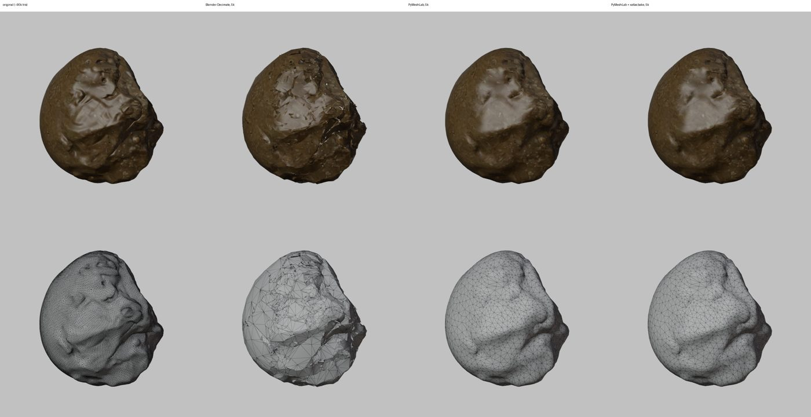
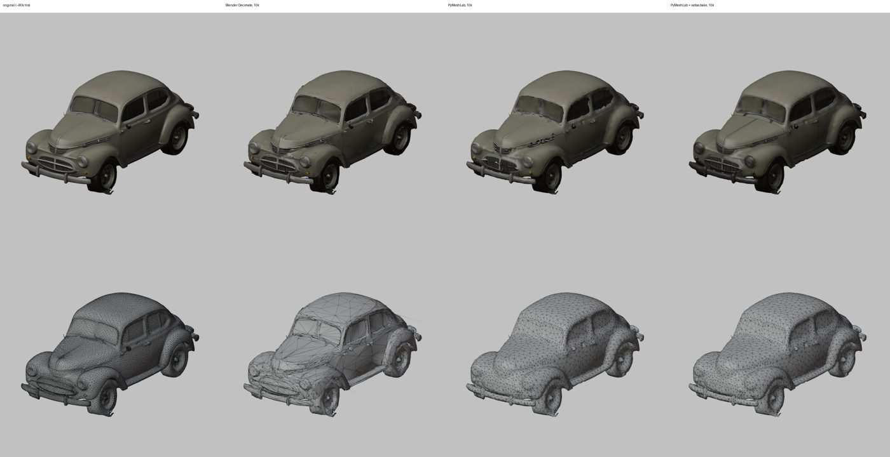
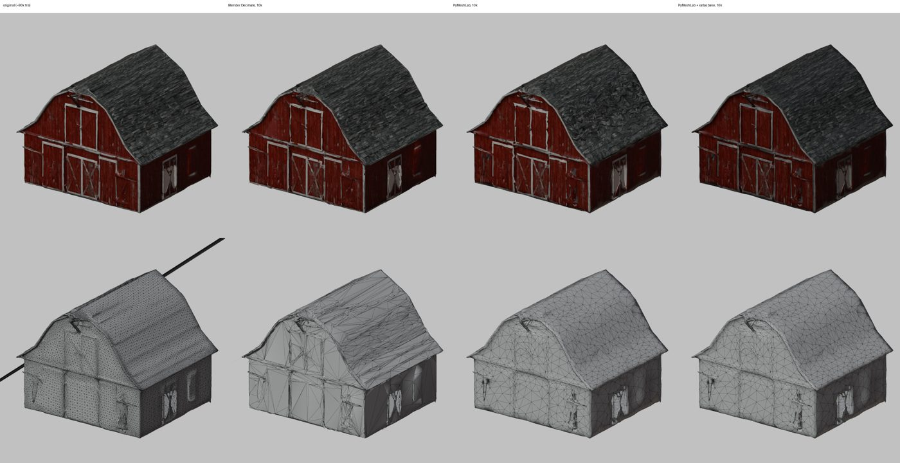
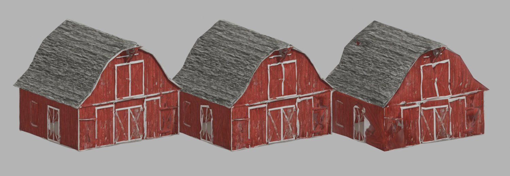
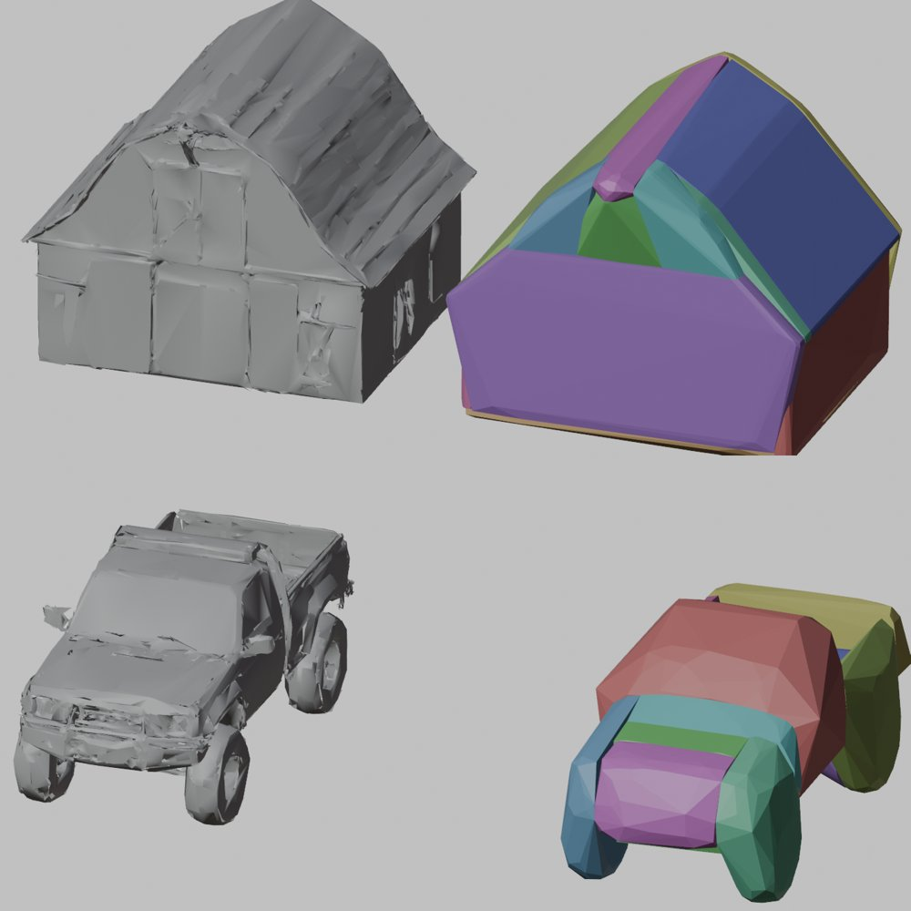
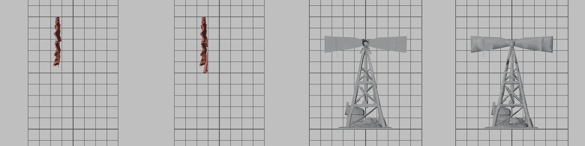

# Game tools: generated models made ready for a game

Four headless Blender steps that take a generator's model (Rodin, Tripo, Meshy) to what a game imports. They came
from importing Tornado Titans' Tripo batch (Sam, 2026-10-17: the tools live here, not in the game's repository), and
every engine can use them: they write FBX in metres, foot on the ground, facing -Y in Blender (+Z in Unity).

| Command | Step | For |
|---|---|---|
| `run.py game-prop` | `steps/game_prop.py` | a prop, building or vehicle: one FBX with LOD0-2 |
| `run.py game-parts` | `steps/game_parts.py` | a game-prop FBX whose moving parts a game animates: each its own mesh |
| `run.py tripo-clips` | `steps/tripo_clips.py` | an animal Tripo rigged: its own skeleton and skin, with clips |
| `run.py crop-cards` | `steps/crop_cards.py` | plants a field draws by the thousand: flat picture cards |
| `run.py fbx-maps` | `steps/fbx_maps.py` | a rigged FBX from a GLB source: its colour and normal maps saved and wired in |

## game-prop

```
python autorig/cli/run.py game-prop --in barn.glb --name Barn --length 18 --out <folder>
        [--height 9] [--front -y|+y|+x|-x] [--triangles 30000] [--lods 0.4,0.15] [--wind] [--carve-wheels | --wheels]
        [--atlas 2048] [--colliders 12 [--collider-detail 0.08]]
```

- `--front` is the way the model faces as it comes; it is turned to face -Y. (Before 2026-10-17 the turn was silently
  ignored for every GLB, since a glTF import leaves objects in quaternion mode, and +x and -x were swapped; Model
  Studio's vehicle port had the same table and is fixed with it.)
- `--length` sizes the longest footprint side, `--height` the height.
- A GLB's colour and normal maps are saved as `<Name>.fbm/<Name>_basecolor.png` and `_normal.png` and wired straight
  into the material: FBX's exporter does not follow glTF's node graph and dropped the colour map.
- `--carve-wheels`: a truck generated in one piece (Tripo's are thousands of fused fragments) has its tyres cut out.
  Each ground contact is a tyre; the chord of its circle a little above the ground, from the mesh's edges (so a
  low-poly tyre works), gives its radius; an axle's two tyres share their place and size; a corner hidden by a low
  door is mirrored from the other side; a second rear axle becomes `Wheel_RL2`/`Wheel_RR2`. When a corner cannot be
  told from the body (the Peanut's tyres sit up under its bumper) the FBX carries an empty `Wheels_Baked` instead, so
  a game can hide its own wheels rather than show two sets. `--wheels` takes a truck already split into parts.
- `--wind`: height-based vertex alpha for a wind shader (trees, bushes).
- `--atlas N`: re-texture the base mesh. It is cut to `--triangles` with PyMeshLab, given a fresh xatlas UV atlas, and
  the full-resolution model is baked onto it (Cycles on the CPU, selected to active): `<Name>.fbm/<Name>_basecolor.png`
  and a tangent-space `_normal.png` that carries the dense surface's detail, N x N, one material. See "Mesh prep with
  the extras" below for why.
- `--colliders N`: up to N convex pieces (CoACD) as `<Name>_Collider_00`, `_01`... under the root beside the LODs,
  without materials, each under Unity's 255-triangle limit for a convex MeshCollider. The importer is the game's: it
  should give each a `MeshCollider` with `convex = true` and turn its renderer off. `--collider-detail` is CoACD's
  concavity threshold (lower follows the shape closer, with more pieces). About 50 s for a barn, 20 s for a truck.
- With the manifold3d extra, `--carve-wheels` cuts each tyre out with a cylinder rather than taking whole faces, when
  the body is a closed surface; a Tripo truck's body is not (see below), so its tyres still go by face centres.

## game-parts

```
python autorig/cli/run.py game-parts --in Pumpjack.fbx --spec autorig/specs/tornado_titans_parts.json --out <folder>
        [--name Pumpjack] [--renders <folder>] [--survey]
```

A generated model is one mesh, often thousands of loose fragments, so nothing on it can move. This takes the FBX
game-prop wrote and a JSON spec of named parts, and writes the FBX again with each part cut out of `<Name>_LOD0` as
its own mesh object, `<Name>_<Part>` (`Pumpjack_Beam`, `Windpump_Fan`), beside the LODs under the root, its origin
at the part's pivot. LOD1 and LOD2 stay whole (far off, nothing needs to move), so an engine adds the parts to its
LOD0 renderers itself. Export is game-prop's (-Z forward, Y up, unit scale applied, no leaf bones); the maps stay in
`<Name>.fbm` beside the FBX (copied there when `--out` is another folder) and the FBX names them there. Run on its
own output, the parts are joined back into LOD0 first, so a spec can be tuned and run again.

A part takes whole fragments (connected components; a face is never split) whose centre lies in one of its regions
and in none of its `exclude` regions; the first part listed that takes a fragment keeps it. Coordinates are
Blender's: metres, Z up, front -Y.

```json
{"Windpump": {"parts": [
  {"name": "Fan", "disc": {"centre": [0.02, -1.4, 7.645], "axis": "y", "radius": 2.7, "slab": [-0.48, 0.36]},
   "exclude": [{"box": {"min": [-3, -2, 0], "max": [3, -0.9, 5.5]}}],
   "max_size": [9, 9, 1.6], "pivot": [0.02, -1.4, 7.645]}]}}
```

- a region is `"box": {"min", "max"}` or `"disc": {"centre", "axis" (x, y, z or a vector), "radius", "slab": [from,
  to] along the axis}`; several go in `"regions": [...]`;
- `max_size: [dx, dy, dz]` leaves out a fragment bigger than that (a tower's legs run up behind a fan: long where
  its blades are short);
- `pivot` is a point, or `"centre"`: the middle of what the part took (for a disc, across its axis only, unless
  `"recentre_axis": true`). A lopsided generated fan is best given its hub as a point;
- `"cut": true` carves the part instead of taking whole fragments: everything inside its one region (no `exclude`
  or `max_size`), and a fragment the region crosses is cut through along the region's surface and closed where it
  is cut (manifold3d; UVs and materials carried, the cap faces textured from the nearest surface). That is for a
  part fused into the body in one piece. A fragment that is not a closed surface once its UV seams are welded falls
  back to its faces' centres, and so does everything without the manifold3d extra. Cut parts are cut first, in order.
  On Rodin's windpump (one closed surface once welded) the fan cut as a disc left the fan and the body each with 0
  open edges where whole fragments had left 129.

`--survey` writes every fragment's centre, bounds and face count to `<renders>/<Name>_fragments.json`, for finding
the numbers; `--renders` draws the model before (textured) and after (each part its own colour), the model left
behind, and each part alone, from the side and the front over a metre grid whose axes are drawn thicker. Check
those before shipping a cut: everything of the part in it, and nothing that should stay.

`autorig/specs/tornado_titans_parts.json` holds Tornado Titans' five (Rodin's and Tripo's pumpjacks and three
windpumps): pumpjack Beam (walking beam and horse head, pivot at the bearing), Rod (bridle and polished rod under the
head), Link (Rodin's slanted rear frame, pivot at its foot so the game can stretch it to follow the tail) or Pitman
(Tripo's arms, pivot at the tail), and windpump Fan (pivot at the hub; the tail vane, gearbox and tower stay).

## Mesh prep with the extras

The optional mesh libraries ([EXTRAS.md](EXTRAS.md)) are used through `core/mesh_prep.py` (plain numpy arrays, no
bpy, so Blender's Python tests it on its own) and `core/mesh_bridge.py` (a Blender mesh in and out). Every use checks
that its extra is installed and keeps the plain path otherwise.

| Where | Extra | What |
|---|---|---|
| trim, game-prop LODs, Studio LODs | pymeshlab | quadric collapse: untextured meshes, and LOD1 and down |
| game-prop `--atlas` | pymeshlab, xatlas | collapse, fresh UV atlas, the full model baked onto it |
| game-prop `--colliders` | coacd | convex collider pieces |
| game-prop `--carve-wheels`, game-parts `"cut"` | manifold3d | exact cuts of closed fragments |
| doctor `--repair` | pymeshlab | duplicates, non-manifold edges and vertices, small holes; UVs kept |
| doctor `--watertight [--bake N]` | pymeshfix, manifold3d (xatlas) | one closed surface; the colour baked back |

### Decimation compared

Four Tripo models, each cut from about 90,000 triangles to the same budget by Blender's Decimate and by PyMeshLab's
texture-aware quadric collapse, then PyMeshLab plus a 2048 xatlas bake. Shape: the largest and the mean distance
between the two surfaces (both ways, 20,000 area-weighted samples), as a percentage of the model's diagonal. Picture:
the mean per-pixel difference (0-255) from the original in a textured render from the same camera.

| Model (budget) | Max dev. Blender | Max dev. PyMeshLab | Mean dev. Blender | Mean dev. PyMeshLab | Render diff. Blender | PyMeshLab | PyMeshLab + bake |
|---|---|---|---|---|---|---|---|
| Boulder (5,000) | 1.19% | **0.44%** | 0.097% | **0.046%** | 2.76 | 2.04 | **1.96** |
| Church (10,000) | 0.63% | **0.38%** | 0.028% | **0.025%** | 1.76 | **1.59** | 2.47 |
| Car, vintage (10,000) | 0.53% | **0.40%** | 0.035% | **0.034%** | **1.52** | 1.68 | 2.19 |
| Barn (10,000) | 0.81% | **0.50%** | **0.026%** | 0.037% | **2.29** | 3.66 | 4.65 |





What it shows (each sheet: original, Blender, PyMeshLab, PyMeshLab + bake; wireframes below):

- **Shape:** PyMeshLab is better everywhere: its largest error is 25-63% smaller, and it leaves no shards, slivers or
  spikes (Blender's boulder is splintered, its car has a spike off the back).
- **Texture:** even the texture-aware variant smears Tripo's atlases at UV seams and across big flat areas (the barn's
  roof swirls, the car's grille and windows smear), because those atlases are not linear across such areas and its
  collapse covers them with big triangles. Its settings (UV weight, optimal placement, planar quadric) made no
  difference.
- **The bake** removes the smearing (the barn's roof, the car's grille). Its render difference is higher mostly
  because the bake applies the material's colour factor (a little darker; Workbench shows the raw image) and
  resamples fine detail.

So the library collapse is used where the silhouette is what shows or there is no texture: untextured static meshes
in trim, game-prop's LOD1 and LOD2, Studio LOD1 and down, and the base mesh when `--atlas` re-bakes it. A textured
mesh seen close stays on Blender's Decimate. `AUTORIG_COLLAPSE=blender` turns the library off, `pymeshlab` uses it
for everything. When PyMeshLab stops well short of its budget (it will not collapse across seams, and on a mesh
Blender had already cut it stalled at 9,934 of 4,000), the LOD goes to Blender's Decimate.



### Colliders



CoACD's defaults took nearly three minutes on the barn; game-prop uses a lighter search (30 MCTS iterations, 8 nodes,
depth 2) and a coarser remesh (30), about 50 s, after cutting a dense input to 4,000 triangles.

### Cuts



manifold3d only cuts a closed 2-manifold. Rodin's models usually are, once their UV seams are welded. Tripo's are
often not: the Ranger truck's body has 21 non-manifold edges and 910 open ones, and still 9 open edges after a
PyMeshLab repair that closes holes up to 300 edges, so it falls back to face centres.

## tripo-clips

```
python autorig/cli/run.py tripo-clips --in Dog_rigged.glb --name Dog --height 0.62 --out <folder> [--triangles 15000] [--front +x]
```

Tripo's animals are fragments, so re-skinning them (`rig.json` kind `tripo`) tears them apart, while Tripo's own
weights hold. This keeps Tripo's skeleton and skin and keys **idle, walk, trot and gallop** on its leg chains
(`<n>_Left_Limb_0..`; the pair nearer the head are the front legs; two legs make a biped). The FBX imports as a Generic
rig with the clips as takes (`<Name>|walk`).

The GLB is mended first by `core/tripo_glb.py` (plain Python, `tests/test_tripo_glb.py`):

- NaN numbers in its JSON and NaN texture coordinates become 0;
- a skeleton whose joints all sit at the origin, its rest pose only in the inverse bind matrices (Tripo's horse), gets
  that rest pose back, joint by joint: world = inverse(bind), local = inverse(parent world) x world.

When most of the bind matrices themselves are garbage (Tripo's cat, rabbit and goat of 2026-10-17, unchanged on a
second download), nothing can recover the rig: use the static model, or rig it afresh.

## crop-cards

```
python autorig/cli/run.py crop-cards --out <folder> --card corn_green_front=Corn_MatureGreen.glb:0:0.45 --card wheat_gold=Wheat_Golden.glb
```

`--card <name>=<model>[:<view degrees>[:<wide>]]` writes `<name>.png`: the plant rendered flat (its own colour, no
light; the game lights the card) on transparency, its foot at the bottom middle, 1024 px tall and `wide` times as wide.
A card a game draws on a quad narrower than it is tall but keeps in a square atlas cell is rendered that narrow, so the
atlas stretches it square and the quad squeezes it back.

## fbx-maps

```
python autorig/cli/run.py fbx-maps --fbx <model>/rigged/<model>.fbx --source <model>/<model>.glb --name IceTeen --out <folder>
```

The rig and decimate steps export the FBX without embedding textures, and a GLB keeps its images packed inside the
.glb, so a rigged Tripo person reached Unity untextured (Tornado Titans' story characters, 2026-10-17, through
`rerig_humanoid.py`). This saves the source's base colour and normal maps as `<Name>.fbm/<Name>_basecolor.png` and
`_normal.png` (`game_prop.save_maps`), wires them into the rigged FBX's materials and exports it again as
`<out>/<Name>.fbx` with decimate's settings. The armature, weights and mesh are not touched.
